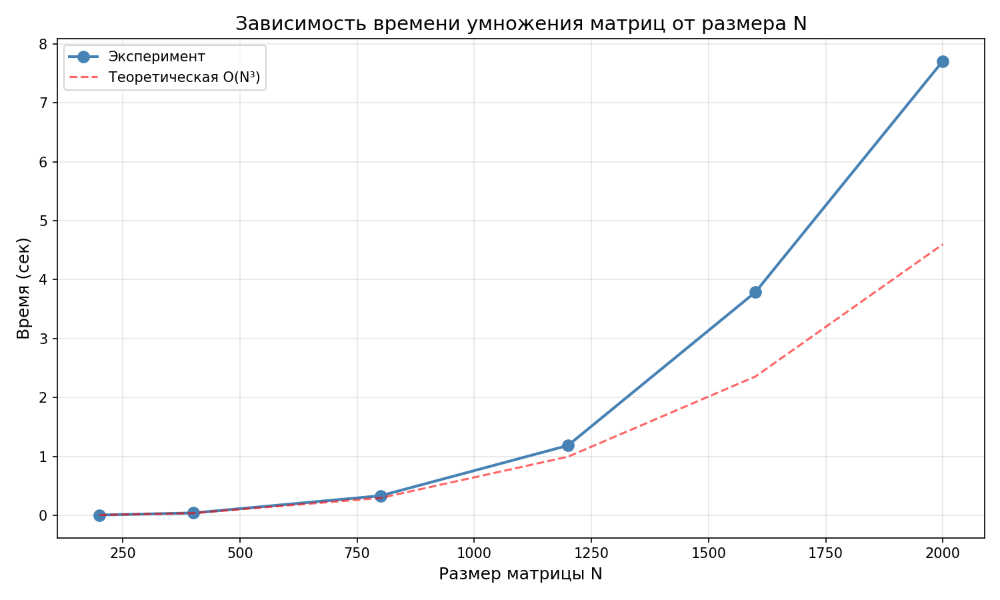
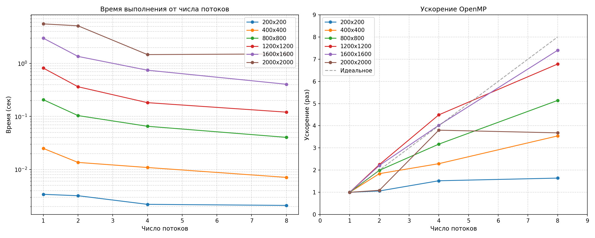

# Лабораторные работы по параллельному программированию

## Описание
Программа на C++ умножает две квадратные матрицы, считывая их из файлов, и сохраняет результат в файл.

## Автор 
Суровцев Илья Курс: Параллельное программирование

## Лабораторная работа №1: Умножение матриц

### Структура проекта
```text
Параллельное программирование/
├── lab1/
│   ├── src/
│   │   ├── main.cpp                  ← исходный код
│   ├── input/                     ← входные матрицы
│   │   ├── matrix_a.txt
│   │   └── matrix_b.txt
│   └── output/                    ← результаты
│   │   ├── result.txt               ← матрица C
│   │   ├── info.txt                 ← время и объём
│   │   ├── experiments.txt          ← таблица экспериментов
│   │   └── graph.png                ← график
│   ├── experiments.py           ← запуск экспериментов
│   └── plot_graphs.py           ← построение графиков
├── generate_matrix.py         ← генератор матриц
├── verify.py                  ← верификация
└── README.md                  ← отчет 
```

### Верификация
```text
========== ВЕРИФИКАЦИЯ ==========
Размер матриц: 200x200
Максимальная ошибка: 0.000000000011823
ВЕРИФИКАЦИЯ ПРОЙДЕНА!
```

### Результаты экспериментов

| N | Время (сек) | Объём задачи (N³) |
| :---: | :---: | :---: |
| 200 | 0.0046 | 8 000 000 |
| 400 | 0.0393 | 64 000 000 |
| 800 | 0.3312 | 512 000 000 |
| 1200 | 1.1848 | 1 728 000 000 |
| 1600 | 3.7871 | 4 096 000 000 |
| 2000 | 7.7097 | 8 000 000 000 |

### График


На графике показана зависимость времени выполнения от размера матрицы N. Синяя линия — эксперимент, красная пунктирная — теоретическая O(N³).

---

## Лабораторная работа №2: OpenMP умножение матриц

### Структура
```text
Параллельное программирование/
├── lab1/
│   ├── src/
│   │   ├── main.cpp                  ← исходный код
│   ├── input/                     ← входные матрицы
│   │   ├── matrix_a.txt
│   │   └── matrix_b.txt
│   └── output/                    ← результаты
│   │   ├── result.txt               ← матрица C
│   │   ├── info.txt                 ← время и объём
│   │   ├── experiments.txt          ← таблица экспериментов
│   │   └── graph.png                ← график
│   ├── experiments.py           ← запуск экспериментов
│   └── plot_graphs.py           ← построение графиков
├── lab2_openmp/
│   ├── src/
│   │   └── main.cpp                  ← исходный код с OpenMP
│   ├── input/
│   │   ├── matrix_a.txt
│   │   └── matrix_b.txt
│   └── output/
│       ├── result.txt
│       ├── info.txt
│       ├── experiments.txt        
│       └── graphs.png             
├── generate_matrix.py         ← генератор матриц
├── verify.py                  ← верификация
└── README.md                  ← отчет 
```

### Результаты экспериментов

| N | Потоки | Время (сек) | Ускорение | Эффективность |
| :---: | :---: | :---: | :---: | :---: |
| 200 | 1 <br> 2 <br> 4 <br> 8 | 0.0034 <br> 0.0032 <br> 0.0022 <br> 0.0021 | 1.00 <br> 1.06 <br> 1.52 <br> 1.64 | 100.0% <br> 53.1% <br> 37.9% <br> 20.5% |
| 400 | 1 <br> 2 <br> 4 <br> 8 | 0.0250 <br> 0.0136 <br> 0.0109 <br> 0.0071 | 1.00 <br> 1.84 <br> 2.29 <br> 3.54 | 100.0% <br> 92.0% <br> 57.2% <br> 44.3% |
| 800 | 1 <br> 2 <br> 4 <br> 8 | 0.2075 <br> 0.1040 <br> 0.0654 <br> 0.0404 | 1.00 <br> 1.99 <br> 3.17 <br> 5.14 | 100.0% <br> 99.7% <br> 79.3% <br> 64.3% |
| 1200 | 1 <br> 2 <br> 4 <br> 8 | 0.8194 <br> 0.3642 <br> 0.1824 <br> 0.1208 | 1.00 <br> 2.25 <br> 4.49 <br> 6.78 | 100.0% <br> 112.5% <br> 112.3% <br> 84.8% |
| 1600 | 1 <br> 2 <br> 4 <br> 8 | 3.0043 <br> 1.3596 <br> 0.7473 <br> 0.4059 | 1.00 <br> 2.21 <br> 4.02 <br> 7.40 | 100.0% <br> 110.5% <br> 100.5% <br> 92.5% |
| 2000 | 1 <br> 2 <br> 4 <br> 8 | 5.5863 <br> 5.1409 <br> 1.4713 <br> 1.5161 | 1.00 <br> 1.09 <br> 3.80 <br> 3.68 | 100.0% <br> 54.3% <br> 94.9% <br> 46.1% |

### Графики


Слева: зависимость времени выполнения от числа потоков (логарифмическая шкала).  
Справа: ускорение относительно 1 потока, сравнение с идеальным ускорением.

---

## Лабораторная работа №3: MPI умножение матриц

### Структура
```text
Параллельное программирование/
├── lab1/
│   ├── src/
│   │   ├── main.cpp                  
│   ├── input/                     
│   │   ├── matrix_a.txt
│   │   └── matrix_b.txt
│   └── output/                    
│   │   ├── result.txt               
│   │   ├── info.txt                 
│   │   ├── experiments.txt          
│   │   └── graph.png                
│   ├── experiments.py           
│   └── plot_graphs.py           
├── lab2_openmp/
│   ├── src/
│   │   └── main.cpp                  
│   ├── input/
│   │   ├── matrix_a.txt
│   │   └── matrix_b.txt
│   └── output/
│       ├── result.txt
│       ├── info.txt
│       ├── experiments.txt        
│       └── graphs.png             
├── lab3_mpi/
│   ├── input/     ← папка для генерации временных матриц A и B
│   │   ├── matrix_a.txt
│   │   └── matrix_b.txt                  
│   ├── output/                    ← результаты
│   │   ├── result.txt               ← результирующая матрица C
│   │   ├── time_graph.png           ← график времени расчета (мс)
│   │   └── speedup_graph.png        ← график ускорения
│   ├── main.cpp                   ← исходный код программы с технологией MPI
│   ├── job.sh                     ← bash-скрипт автоматизации для SLURM
│   ├── results.txt                ← сохраненная таблица экспериментов
│   └── plot_graphs.py             ← локальный скрипт построения графиков
├── generate_matrix.py         
├── verify.py                  
└── README.md                  
```

### Результаты экспериментов

| N | Ядра | Время (сек) | Ускорение | Эффективность |
| :---: | :---: | :---: | :---: | :---: |
| 200 | 1 <br> 2 <br> 4 <br> 8 | 0.0073 <br> 0.0037 <br> 0.0019 <br> 0.0009 | 1.00 <br> 1.97 <br> 3.84 <br> 8.11 | 100.0% <br> 98.5% <br> 96.0% <br> 101.4% |
| 400 | 1 <br> 2 <br> 4 <br> 8 | 0.0576 <br> 0.0288 <br> 0.0145 <br> 0.0072 | 1.00 <br> 2.00 <br> 3.97 <br> 8.00 | 100.0% <br> 100.0% <br> 99.3% <br> 100.0% |
| 800 | 1 <br> 2 <br> 4 <br> 8 | 0.4579 <br> 0.2271 <br> 0.1198 <br> 0.1123 | 1.00 <br> 2.02 <br> 3.82 <br> 4.08 | 100.0% <br> 101.0% <br> 95.5% <br> 51.0% |
| 1200 | 1 <br> 2 <br> 4 <br> 8 | 1.5946 <br> 0.8048 <br> 0.5316 <br> 0.3976 | 1.00 <br> 1.98 <br> 3.00 <br> 4.01 | 100.0% <br> 99.0% <br> 75.0% <br> 50.1% |
| 1600 | 1 <br> 2 <br> 4 <br> 8 | 4.1638 <br> 2.1852 <br> 1.2388 <br> 0.9379 | 1.00 <br> 1.91 <br> 3.36 <br> 4.44 | 100.0% <br> 95.5% <br> 84.0% <br> 55.5% |
| 2000 | 1 <br> 2 <br> 4 <br> 8 | 8.0229 <br> 4.1147 <br> 2.4869 <br> 1.8428 | 1.00 <br> 1.95 <br> 3.23 <br> 4.35 | 100.0% <br> 97.5% <br> 80.8% <br> 54.4% |

### Графики


*   **График времени:** Демонстрирует изменение времени счета в миллисекундах от размера $N$ при использовании разного числа MPI-процессов (логарифмическая шкала).
*   **График ускорения:** Показывает реальное ускорение алгоритма относительно 1 ядра для ключевых трудоемких матриц ($N=800, 1600, 2000$) в сравнении с идеальной линейной зависимостью.
