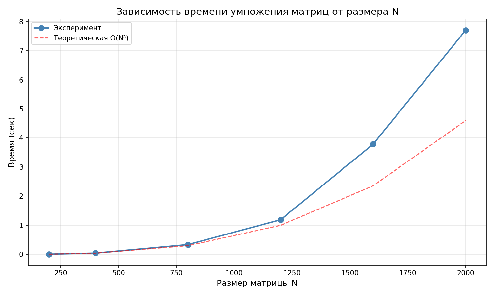
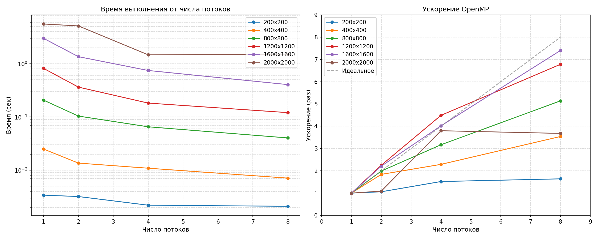

# Лабораторные работы по параллельному программированию

## Описание
Программа на C++ умножает две квадратные матрицы, считывая их из файлов, и сохраняет результат в файл.

## Автор 
Суровцев Илья Курс: Параллельное программирование

## Лабораторная работа №1: Умножение матриц

### Структура проекта
```text
Параллельное программирование/
├── lab1/
│   ├── src/
│   │   ├── main.cpp                  ← исходный код
│   ├── input/                     ← входные матрицы
│   │   ├── matrix_a.txt
│   │   └── matrix_b.txt
│   └── output/                    ← результаты
│   │   ├── result.txt               ← матрица C
│   │   ├── info.txt                 ← время и объём
│   │   ├── experiments.txt          ← таблица экспериментов
│   │   └── graph.png                ← график
│   ├── experiments.py           ← запуск экспериментов
│   └── plot_graphs.py           ← построение графиков
├── generate_matrix.py         ← генератор матриц
├── verify.py                  ← верификация
└── README.md                  ← отчет 
```

### Верификация
```text
========== ВЕРИФИКАЦИЯ ==========
Размер матриц: 200x200
Максимальная ошибка: 0.000000000011823
ВЕРИФИКАЦИЯ ПРОЙДЕНА!
```

### Результаты экспериментов

| N | Время (сек) | Объём задачи (N³) |
| :---: | :---: | :---: |
| 200 | 0.0046 | 8 000 000 |
| 400 | 0.0393 | 64 000 000 |
| 800 | 0.3312 | 512 000 000 |
| 1200 | 1.1848 | 1 728 000 000 |
| 1600 | 3.7871 | 4 096 000 000 |
| 2000 | 7.7097 | 8 000 000 000 |

### График


На графике показана зависимость времени выполнения от размера матрицы N. Синяя линия — эксперимент, красная пунктирная — теоретическая O(N³).

---

## Лабораторная работа №2: OpenMP умножение матриц

### Структура
```text
Параллельное программирование/
├── lab1/
│   ├── src/
│   │   ├── main.cpp                  ← исходный код
│   ├── input/                     ← входные матрицы
│   │   ├── matrix_a.txt
│   │   └── matrix_b.txt
│   └── output/                    ← результаты
│   │   ├── result.txt               ← матрица C
│   │   ├── info.txt                 ← время и объём
│   │   ├── experiments.txt          ← таблица экспериментов
│   │   └── graph.png                ← график
│   ├── experiments.py           ← запуск экспериментов
│   └── plot_graphs.py           ← построение графиков
├── lab2_openmp/
│   ├── src/
│   │   └── main.cpp                  ← исходный код с OpenMP
│   ├── input/
│   │   ├── matrix_a.txt
│   │   └── matrix_b.txt
│   └── output/
│       ├── result.txt
│       ├── info.txt
│       ├── experiments.txt        
│       └── graphs.png             
├── generate_matrix.py         ← генератор матриц
├── verify.py                  ← верификация
└── README.md                  ← отчет 
```

### Результаты экспериментов

| N | Потоки | Время (сек) | Ускорение | Эффективность |
| :---: | :---: | :---: | :---: | :---: |
| 200 | 1 <br> 2 <br> 4 <br> 8 | 0.0034 <br> 0.0032 <br> 0.0022 <br> 0.0021 | 1.00 <br> 1.06 <br> 1.52 <br> 1.64 | 100.0% <br> 53.1% <br> 37.9% <br> 20.5% |
| 400 | 1 <br> 2 <br> 4 <br> 8 | 0.0250 <br> 0.0136 <br> 0.0109 <br> 0.0071 | 1.00 <br> 1.84 <br> 2.29 <br> 3.54 | 100.0% <br> 92.0% <br> 57.2% <br> 44.3% |
| 800 | 1 <br> 2 <br> 4 <br> 8 | 0.2075 <br> 0.1040 <br> 0.0654 <br> 0.0404 | 1.00 <br> 1.99 <br> 3.17 <br> 5.14 | 100.0% <br> 99.7% <br> 79.3% <br> 64.3% |
| 1200 | 1 <br> 2 <br> 4 <br> 8 | 0.8194 <br> 0.3642 <br> 0.1824 <br> 0.1208 | 1.00 <br> 2.25 <br> 4.49 <br> 6.78 | 100.0% <br> 112.5% <br> 112.3% <br> 84.8% |
| 1600 | 1 <br> 2 <br> 4 <br> 8 | 3.0043 <br> 1.3596 <br> 0.7473 <br> 0.4059 | 1.00 <br> 2.21 <br> 4.02 <br> 7.40 | 100.0% <br> 110.5% <br> 100.5% <br> 92.5% |
| 2000 | 1 <br> 2 <br> 4 <br> 8 | 5.5863 <br> 5.1409 <br> 1.4713 <br> 1.5161 | 1.00 <br> 1.09 <br> 3.80 <br> 3.68 | 100.0% <br> 54.3% <br> 94.9% <br> 46.1% |

### Графики


Слева: зависимость времени выполнения от числа потоков (логарифмическая шкала).  
Справа: ускорение относительно 1 потока, сравнение с идеальным ускорением.
